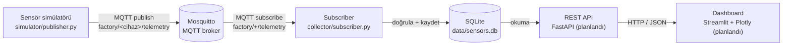

# Mimari

Bu belge projenin planlanan mimarisini ve her bileşenin bugünkü durumunu anlatır.
Yeni bir katman eklendiğinde ya da bir karar değiştiğinde güncellenir.

## Genel Bakış

Sistem, birbirinden bağımsız çalışan küçük süreçlerden oluşur. Bileşenler birbirini
doğrudan çağırmaz; aralarında yalnızca MQTT mesajları ve SQLite veritabanı vardır.



| Bileşen | Klasör | Sorumluluk | Durum |
|---|---|---|---|
| Ayarlar | `config.py` | `.env` ve ortam değişkenlerinden ayarları okur, doğrular | Tamamlandı |
| Sensör simülatörü | `simulator/sensor.py` | Bir cihaz için rastgele ölçüm üretir | Tamamlandı |
| Publisher | `simulator/publisher.py` | Her cihazın ölçümünü belirli aralıkla MQTT'ye gönderir | Tamamlandı |
| Broker | Mosquitto (Windows servisi) | Mesajları publisher'dan subscriber'a iletir | Kurulu |
| Subscriber | `collector/subscriber.py` | Mesajları dinler, doğrular, veritabanına yazar | Tamamlandı |
| Depolama | `storage/database.py` | Tablo şeması, kayıt ekleme ve sorgulama | Tamamlandı |
| REST API | `api/` | Veritabanındaki ölçümleri HTTP üzerinden sunar | Planlandı (PR #3) |
| Dashboard | `dashboard/` | Canlı grafikler, cihaz seçici, alarm eşikleri | Planlandı (PR #4) |

## Veri Akışı

1. Publisher, `DEVICE_IDS` içindeki her cihaz için `PUBLISH_INTERVAL_SECONDS` aralıkla bir ölçüm üretir.
2. Ölçüm JSON olarak `<MQTT_TOPIC_PREFIX>/<cihaz-kimliği-küçük-harf>/telemetry` topic'ine QoS 1 ile gönderilir.
3. Subscriber `<MQTT_TOPIC_PREFIX>/+/telemetry` filtresine abonedir; `+` tek seviyeli joker karakter olduğu için bütün cihazları tek abonelikle alır.
4. Gelen her mesaj doğrulanır. Geçersiz mesaj loglanıp atlanır, geçerli mesaj `readings` tablosuna yazılır.
5. API ve dashboard yalnızca veritabanını okur; MQTT'ye bağlanmazlar.

## Mesaj Biçimi

```json
{
  "device_id": "MOTOR-001",
  "timestamp": "2026-11-28T09:00:00.123456+00:00",
  "temperature": 54.21,
  "humidity": 47.8,
  "vibration": 3.12,
  "current": 8.5
}
```

| Alan | Birim | Simülatör aralığı |
|---|---|---|
| `temperature` | °C | 25 – 85 |
| `humidity` | % | 30 – 70 |
| `vibration` | mm/s | 0 – 10 |
| `current` | A | 2 – 15 |

Subscriber'ın doğruladıkları:

- Mesaj bir JSON nesnesi olmalı.
- `device_id` boş olmayan bir metin olmalı ve topic'teki cihaz segmentiyle eşleşmeli. Böylece bir cihaz başka bir cihaz adına veri yazamaz.
- `timestamp` saat dilimi içeren ISO 8601 biçiminde olmalı; kayıtta UTC'ye çevrilir.
- Dört ölçüm alanı sonlu bir sayı olmalı. `true`/`false`, `NaN` ve sonsuz değerler reddedilir.

Ölçümlerin normal aralıkta olup olmadığı **kontrol edilmez**. Aralık dışı bir değer arızaya
işaret edebilir ve kaybolmaması gerekir; bu değerler dashboard'da alarm olarak gösterilecektir.

## Veritabanı Şeması

```sql
CREATE TABLE readings (
    id          INTEGER PRIMARY KEY AUTOINCREMENT,
    device_id   TEXT    NOT NULL,
    timestamp   TEXT    NOT NULL,  -- ölçümün alındığı an (UTC, ISO 8601)
    temperature REAL    NOT NULL,
    humidity    REAL    NOT NULL,
    vibration   REAL    NOT NULL,
    current     REAL    NOT NULL,
    received_at TEXT    NOT NULL   -- subscriber'ın mesajı aldığı an (UTC, ISO 8601)
);
CREATE INDEX idx_readings_device_time ON readings (device_id, timestamp);
```

- Zaman damgaları UTC ve ISO 8601 metni olarak tutulur. Bu biçim metin olarak sıralandığında zamana göre de doğru sıralanır.
- `(device_id, timestamp)` indeksi, dashboard'un en sık yapacağı "bir cihazın son ölçümleri" sorgusunu hızlandırır.
- `timestamp` ile `received_at` farkı, mesajın broker üzerinden ne kadar gecikmeyle geldiğini gösterir.

## Tasarım Kararları

| Karar | Gerekçe |
|---|---|
| Bileşenler arasında MQTT kullanılması | Sensörler ve panel birbirini tanımadan çalışır; yeni cihaz eklemek için kod değişmez. Dersin asenkron mesajlaşma konusuyla örtüşür. |
| QoS 1 (en az bir kez) | Ölçümlerin kaybolmaması istenir. Nadiren tekrar gelen bir ölçüm grafikte sorun yaratmaz; QoS 2'nin ek maliyetine gerek yoktur. |
| SQLite | Kurulum gerektirmez, tek dosyadır, tek makinede çalışan bu proje için yeterlidir. |
| Subscriber'ın veritabanına yazan tek bileşen olması | Yazma işlemi tek yerde toplanır; API ve dashboard yalnızca okur. |
| Abonelik `on_connect` içinde yapılır | Bağlantı koparsa paho yeniden bağlandığında abonelik de yeniden kurulur. |
| İstemci kimliği (`client_id`) parametre olarak verilebilir | Broker aynı kimlikle bağlanan ikinci istemcide ilkini düşürür; testler ve birden çok örnek ayrı kimlik kullanır. |
| Ayarlar `.env` dosyasından okunur | Ortama özgü değerler koddan ayrılır; `.env` repoya girmez, örneği `.env.example` dosyasındadır. |
| Broker'da kimlik doğrulama yok | Mosquitto 2.x varsayılan olarak yalnızca `127.0.0.1` ve `::1` adreslerini dinler; ağdan erişilemez. Kod `MQTT_USERNAME` / `MQTT_PASSWORD` ile kimlik doğrulamaya hazırdır. |

## Testler

| Tür | Dosyalar | Kapsam |
|---|---|---|
| Birim | `tests/test_config.py`, `test_sensor.py`, `test_publisher.py`, `test_subscriber.py`, `test_database.py` | Broker gerektirmez; MQTT istemcisi yerine sahte nesneler kullanılır. |
| Entegrasyon | `tests/test_mqtt_integration.py` | Gerçek zinciri çalıştırır: publisher → Mosquitto → subscriber → SQLite. Broker yoksa otomatik atlanır. |
